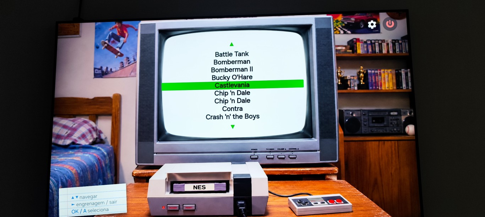
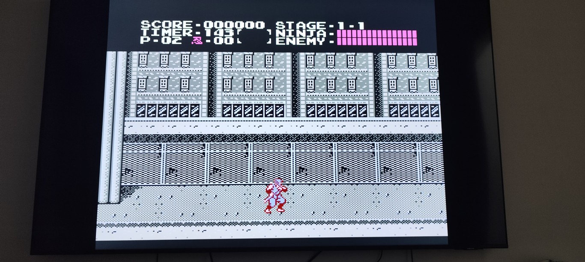
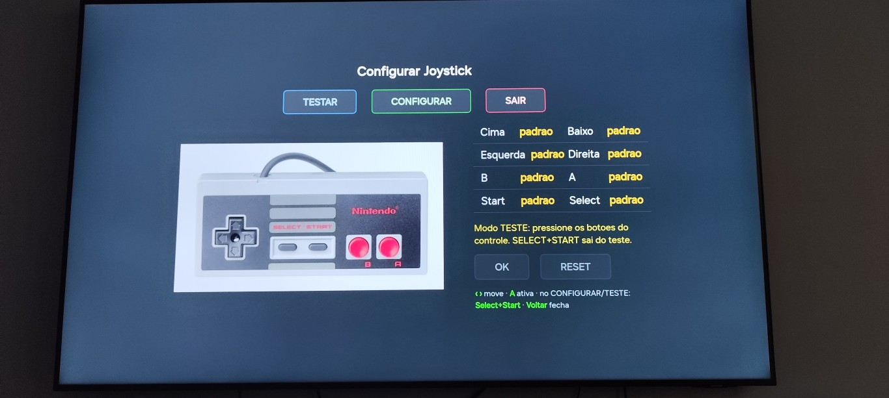
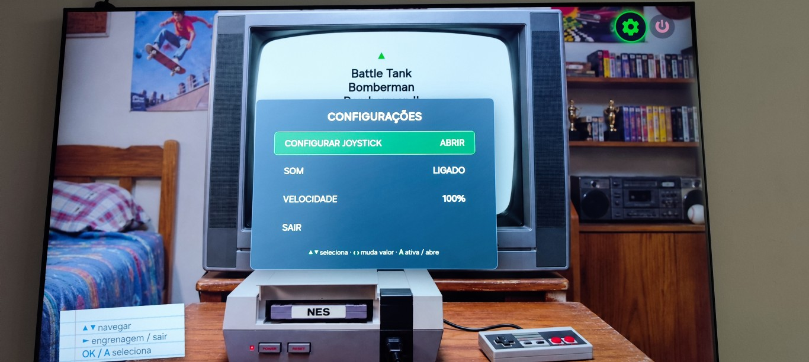
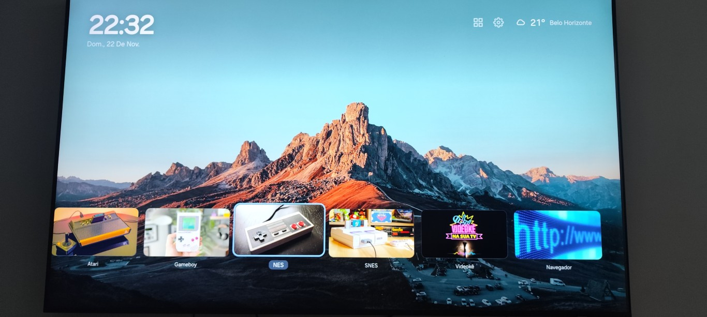

# 🎮 Emulador de NES para Smart TV Samsung (Tizen)

Jogue **Nintendo Entertainment System (NES)** na sua **Smart TV Samsung**. Um aplicativo web independente (`.wgt`) instalado por **sideload** na TV, rodando o núcleo **FCEUmm** compilado para **WebAssembly** em velocidade cheia no SoC modesto da TV. Abre pela tela inicial do [lilauncher](https://github.com/mendes79/lilauncher) ou direto pela lista de aplicativos da TV.

> Sem root. Sem binário nativo. Apenas a WebView da própria TV. Não afiliado à Nintendo nem à Samsung.

|  |  |
| :---: | :---: |
|  |  |
| _Jogo em velocidade cheia (FCEUmm em WASM)_ | _Configuração interativa do joystick_ |
|  |  |
| _Configurações: som e presets de velocidade_ | _Abre pela tela inicial do lilauncher_ |

## ▶️ Demonstração

_Vídeo de demonstração em breve._

## Por que existe

As TVs Tizen da Samsung de 2022 trazem um motor web Chromium M85 travado, sem SIMD e sem threads no WebAssembly. A maioria das builds de emulador simplesmente não valida nem roda. Este projeto entrega uma **build enxuta de WebAssembly, single-thread e escalar** do FCEUmm que roda em velocidade cheia nesse motor, dentro de uma interface pensada para a TV, controlada por gamepad.

## O que é

- Dispositivo alvo: Samsung 65BU8000 (2022, Crystal UHD), Tizen 6.5, motor web Chromium M85.
- Núcleo: FCEUmm recompilado para um módulo WebAssembly enxuto, single-thread e escalar (sem SIMD, sem threads), para validar e rodar no antigo Chromium M85.
- Entregue como pacote Tizen `.wgt`. É a mesma WebView usada pelo navegador da TV, então não há binário nativo do lado do app.

## Funcionalidades

- Emulação em velocidade cheia na TV alvo (validada por um medidor honesto: quadros emulados por segundo real, não FPS nominal).
- Tela de seleção de jogos sobre um wallpaper temático, com navegação vertical e painel de Configurações.
- Configurações: som ligado/desligado e presets de redução de velocidade (100%, -6%, -8%, -10%), salvos localmente.
- Configuração interativa de joystick: um assistente mapeia cada botão (direcional, A, B, Select, Start), com a foto real do controle destacando o botão pressionado.
- Controle: 8BitDo Ultimate 2.4G (dongle USB HID) via Gamepad API. Select+Start volta ao carrossel a partir de um jogo.
- Separação do catálogo: ROMs comerciais privadas ficam locais e nunca são publicadas; ROMs livres ficam em `roms_pub/`.

## ROM livre incluída

- 240p Test Suite (NES) por Damian Yerrick (com base na 240p Test Suite original de Artemio Urbina), GNU GPL v2 ou posterior. Um conjunto de testes de vídeo que também serve como ROM de teste livre do emulador. Veja `roms_pub/CREDITS.md`.

## Estrutura do repositório

- `index.html` mais `js/` : o aplicativo (UI, input, áudio, HUD, adaptador de frontend libretro).
- `js/fceumm.wasm` / `js/fceumm.js` : o núcleo compilado.
- `core/` : registro de build do núcleo (build reproduzível com Emscripten 3.1.56).
- `img/` : wallpaper, ícone, foto do controle e overlays de destaque.
- `roms_pub/` : ROMs livremente distribuíveis (publicadas).
- `roms/`, `roms.json` : ROMs comerciais privadas e catálogo (git-ignored, não publicadas).

## Instalação

### 1. Ative o Modo Desenvolvedor na TV

1. Na tela de Apps, digite `1 2 3 4 5` no controle.
2. Ative Modo Desenvolvedor = ON.
3. Informe o IP do seu PC na rede em Host PC IP.
4. Reinicie a TV.

### 2. Monte, assine e instale o app

A Samsung assina cada app da TV com um certificado amarrado ao DUID daquela TV específica, então um `.wgt` pronto não pode ser compartilhado entre TVs. Com o Tizen Studio no Windows, crie um certificado Samsung com o DUID da sua TV, depois monte, assine e instale o app pela rede e abra. É uma configuração única; instalações seguintes são rápidas.

### 3. Adicione suas próprias ROMs

Coloque seus arquivos `.nes` legalmente obtidos numa pasta `roms/` ao lado do `index.html` e liste-os em `roms.json` (git-ignored, mantido privado), depois reinstale o app para que sejam empacotados no `.wgt`.

Precisa do passo a passo detalhado com telas? Veja o guia de instalação: [docs/INSTALACAO.md](docs/INSTALACAO.md) (inglês: [docs/INSTALL.md](docs/INSTALL.md)).

## Licença

- Código original do aplicativo: MIT (veja LICENSE).
- Componentes de terceiros mantêm suas próprias licenças (veja THIRD-PARTY.md): o núcleo FCEUmm sob a GNU GPL v2, e a 240p Test Suite sob GPL v2 ou posterior. Este projeto é livre e não comercial.

## Aviso Legal

Este projeto é um emulador independente e não oficial, desenvolvido apenas para fins educacionais.

- Este repositório não inclui ROMs com direitos autorais nem assets proprietários. A única ROM incluída é a 240p Test Suite, livremente distribuível sob GPL v2 ou posterior.
- O usuário deve fornecer suas próprias ROMs de NES legalmente obtidas para jogar outros títulos. ROMs comerciais privadas ficam locais e nunca são publicadas.
- Este projeto não é afiliado, endossado ou associado à Nintendo nem ao Nintendo Entertainment System.
- Todas as marcas e marcas registradas são propriedade de seus respectivos donos.

## Créditos

- [Núcleo FCEUmm](https://github.com/libretro/fceumm): os autores do FCEUmm e a equipe do [libretro](https://www.libretro.com/).
- [240p Test Suite (mini)](https://github.com/pinobatch/240p-test-mini): Damian Yerrick, com base na [240p Test Suite original](https://github.com/ArtemioUrbina/240pTestSuite) de Artemio Urbina.
- Foto do controle: [Ravi Palwe na Unsplash](https://unsplash.com/photos/_JTF0Prc7jc) (Licença Unsplash).
- Harness de referência do GameBoy e o projeto [lilauncher](https://github.com/mendes79/lilauncher), no qual este emulador se integra.

## Projetos relacionados

- [lilauncher](https://github.com/mendes79/lilauncher) — a tela inicial própria para TV Samsung de onde este emulador abre.
- [SNES Tizen Emulator](https://github.com/mendes79/SNES-Tizen-Emulator) — mesma abordagem, núcleo SNES (snes9x2005).
- [Atari 2600 Tizen Emulator](https://github.com/mendes79/Atari-2600-Tizen-Emulator) — mesma abordagem, núcleo Atari 2600.
- [Videokê TV](https://github.com/mendes79/videoke-tv) — estação de karaokê para a TV, fila em tempo real pelo celular via QR Code, aberta pelo lilauncher.

Versão em inglês: veja [README.md](README.md).
